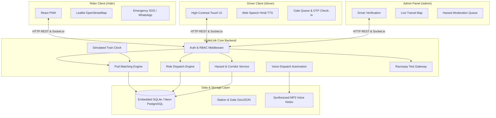
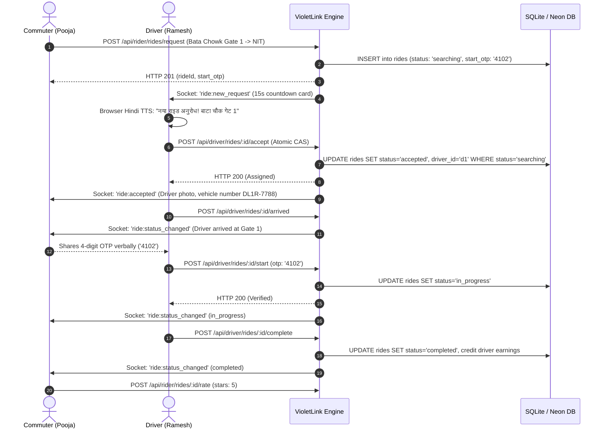

# VioletLink — API & Route Documentation

VioletLink provides a unified REST + WebSocket API server powered by Node.js, Express, and Socket.io with role-based access control (RBAC).

---

## Architecture Diagram



---

## Ride Lifecycle Sequence Diagram



---

## Authentication Endpoints (`/api/auth`)

### 1. `POST /api/auth/register`
Creates a new rider or driver account.
- **Request Body (Rider):**
  ```json
  {
    "name": "Pooja Sharma",
    "phone": "9876543210",
    "password": "password123",
    "role": "rider",
    "emergencyName": "Rajesh Sharma",
    "emergencyPhone": "9876500001"
  }
  ```
- **Request Body (Driver):**
  ```json
  {
    "name": "Ramesh Kumar",
    "phone": "9811122201",
    "password": "password123",
    "role": "driver",
    "vehicleType": "auto",
    "vehicleNumber": "HR38-AA-1029",
    "licenseNumber": "HR-FBD-2018-00912",
    "preferredStation": "bata-chowk",
    "preferredGate": 1
  }
  ```
- **Response:** `201 Created` with JWT token and user profile.

### 2. `POST /api/auth/login`
Authenticates a user and returns a signed JWT.
- **Request Body:**
  ```json
  {
    "identifier": "9876543210",
    "password": "password123",
    "role": "rider"
  }
  ```
- **Response:** `200 OK` `{ "token": "...", "user": { ... } }`

---

## Rider Endpoints (`/api/rider`)
*Requires `Authorization: Bearer <token>` with `role: rider`*

| Method | Endpoint | Description |
|---|---|---|
| `GET` | `/api/rider/stations` | List all 12 Violet Line Faridabad stations |
| `GET` | `/api/rider/station/:slug` | Detailed gates, drop zones, active hazards, and fares |
| `POST` | `/api/rider/rides/request` | Request a solo auto/rickshaw ride |
| `POST` | `/api/rider/pods/join` | Join or create in-train Ride Pod |
| `GET` | `/api/rider/pods/:id` | Live status and co-passenger list (first names only) |
| `GET` | `/api/rider/rides/current` | Active ride details |
| `GET` | `/api/rider/rides/:id` | Public trip details (masked phone numbers) |
| `POST` | `/api/rider/rides/:id/cancel` | Cancel ride (free within 60 seconds) |
| `POST` | `/api/rider/rides/:id/rate` | Submit 1–5 star driver rating |
| `GET` | `/api/rider/rides/history` | Trip history with receipts |
| `POST` | `/api/rider/hazards/report` | One-tap anonymous citizen hazard report |
| `POST` | `/api/rider/hazards/:id/upvote` | Confirm / upvote an active hazard |
| `POST` | `/api/rider/payments/create-order` | Create Razorpay Test Order |
| `POST` | `/api/rider/payments/verify` | Verify HMAC SHA256 payment signature |

---

## Driver Endpoints (`/api/driver`)
*Requires `Authorization: Bearer <token>` with `role: driver`*

| Method | Endpoint | Description |
|---|---|---|
| `GET` | `/api/driver/current` | Profile status, active ride, and online status |
| `PUT` | `/api/driver/toggle-online` | Toggle online/offline (requires `status == 'approved'`) |
| `PUT` | `/api/driver/location` | Update live coordinates (throttled 5s) |
| `GET` | `/api/driver/queue` | Gate queue distribution (autos vs waiting pods) |
| `POST` | `/api/driver/queue/check-in` | Check-in or change preferred gate |
| `GET` | `/api/driver/pod-requests` | Available locked pods ready for pickup |
| `POST` | `/api/driver/rides/:id/accept` | Atomic solo ride claim (first accept wins) |
| `POST` | `/api/driver/pods/:id/claim` | Atomic pod claim (driver takes all passengers) |
| `POST` | `/api/driver/rides/:id/arrived` | Notify rider of arrival at gate |
| `POST` | `/api/driver/rides/:id/start` | Verify rider's 4-digit OTP to start trip |
| `POST` | `/api/driver/rides/:id/complete` | Complete trip and credit fare to earnings |
| `GET` | `/api/driver/earnings` | Earnings breakdown (today & this week) |

---

## Admin Endpoints (`/api/admin`)
*Requires `Authorization: Bearer <token>` with `role: admin`*

| Method | Endpoint | Description |
|---|---|---|
| `GET` | `/api/admin/drivers` | List drivers with filter (`pending`, `approved`, `rejected`) |
| `PUT` | `/api/admin/drivers/:id/status` | Approve or reject driver profile |
| `GET` | `/api/admin/rides/live` | Monitor all active solo trips and forming pods |
| `GET` | `/api/admin/hazards` | Citizen hazard reports moderation queue |
| `PUT` | `/api/admin/hazards/:id` | Update moderation status (`active`, `resolved`, `rejected`) |
| `GET` | `/api/admin/users` | List platform users |
| `PUT` | `/api/admin/users/:id/ban` | Ban or unban a user |
| `GET` | `/api/admin/stats` | Platform KPI statistics |
