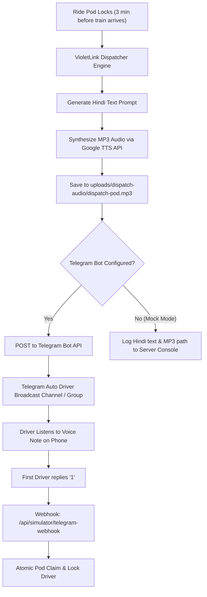

# VioletLink — Voice Dispatch Automation Workflow

VioletLink includes an automated dispatch fallback workflow for auto and e-rickshaw drivers who do not use the mobile web app or operate feature phones without active web sessions.

---

## 1. How It Works



---

## 2. Setting Up Telegram Bot Dispatch (100% Free)

1. Open Telegram and search for [@BotFather](https://t.me/BotFather).
2. Send `/newbot`, name it `VioletLink Faridabad Dispatch`, and give it a username (e.g., `violetlink_fbd_bot`).
3. BotFather will provide an HTTP API Token:
   ```
   7123456789:ABCdefGHIjklMNOpqrSTUvwxYZ12345
   ```
4. Create a Telegram Group or Channel with your auto drivers (e.g., "Bata Chowk Auto Union"). Add your bot as an Administrator.
5. Get the Chat ID of the group (use `@userinfobot` or send a message and inspect `https://api.telegram.org/bot<TOKEN>/getUpdates`).
6. Add the credentials to your `.env`:
   ```env
   TELEGRAM_BOT_TOKEN=7123456789:ABCdefGHIjklMNOpqrSTUvwxYZ12345
   TELEGRAM_DISPATCH_CHAT_ID=-1001234567890
   MOCK_DISPATCH=false
   ```
7. Restart the VioletLink server:
   ```bash
   npm run dev
   ```

---

## 3. Hindi Voice Generation (TTS)

VioletLink synthesizes high-fidelity Hindi audio:
- **Audio Output:** Saved to `uploads/dispatch-audio/dispatch-<podId>.mp3`.
- **Phonetic Phrasing:**
  > *"नमस्ते ड्राइवर भाई! बाटा चौक गेट 1 से NIT फरीदाबाद के लिए नया राइड पॉड तैयार है। कुल किराया ₹100। स्वीकार करने के लिए 1 भेजें।"*
- In local development mock mode, the audio file is generated and can be played directly from the browser or media player.

---

## 4. n8n Community Workflow Integration (Optional)

If running in an **n8n** self-hosted environment:
1. Create a **Webhook Trigger** node listening on `POST /webhook/pod-dispatch`.
2. Connect an **HTTP Request** node to fetch the TTS voice note.
3. Connect a **Telegram Node** (Send Audio / Voice) with `chat_id` set to the auto union channel.
4. Add a **Telegram Trigger** node for replies: if message text equals `"1"`, call `POST /api/driver/pods/:id/claim` on VioletLink with the driver's ID.
